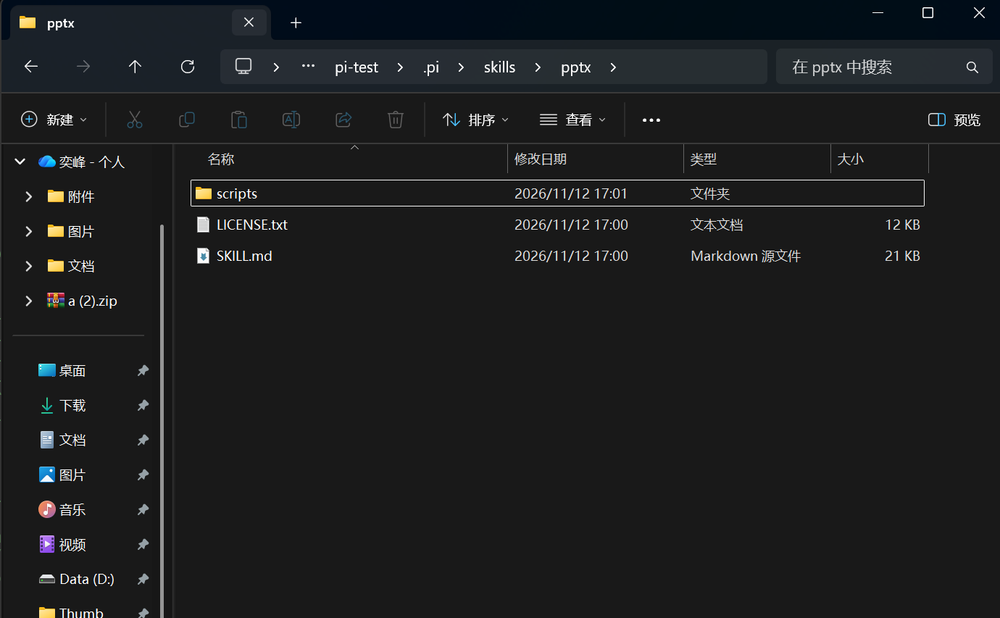
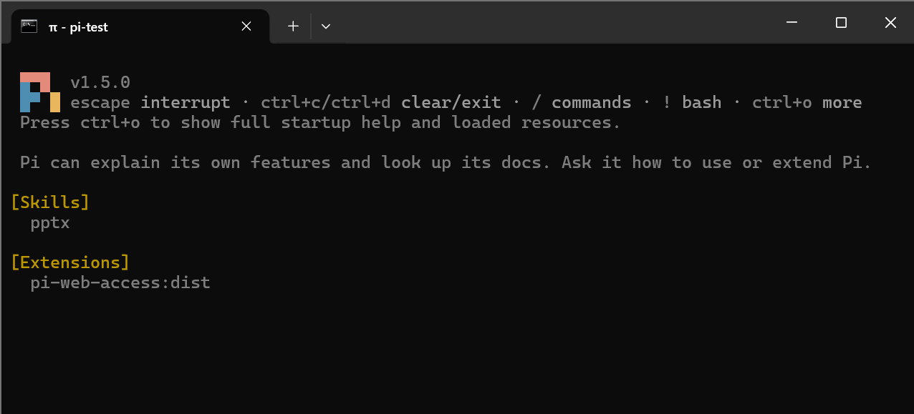
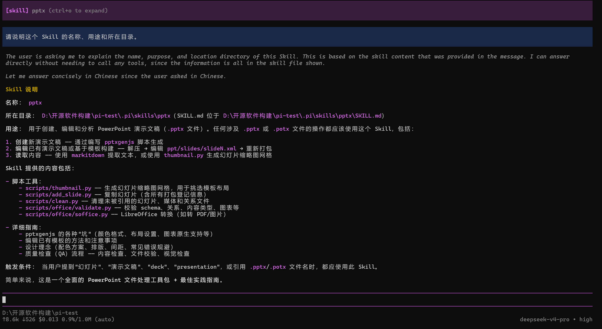

# 实践课1 Pi Agent 安装与使用

## 1 安装和启动（S1）

在 Windows PowerShell 中使用指导书里的官方安装命令安装 Pi。安装器按提示配置了 Node.js、便携版 Git Bash 和用户 PATH。重新打开终端，在练习目录中运行 `pi`，界面显示版本 **v1.5.0** 和工作目录 `~\pi-test`。后续练习移到了 `D:\开源软件构建\pi-test`。


## 2 配置模型并完成首次会话（S2）

在 Pi 中通过 `/login` 选择 API Key 登录方式，配置 DeepSeek。第一次发送「你好」时收到 `402 Insufficient Balance`。随后再次发送「你好」，`deepseek-v4-pro` 回复「你好！有什么可以帮你的吗？」。


## 3 切换模型和思考级别（S3）

| 项目 | 调整前 | 调整后 |
| --- | --- | --- |
| 模型 | `deepseek-v4-pro` | `deepseek-flash` |
| 思考级别（在 Flash 上调整） | `off` | `low` |

使用 `/model` 切换模型后，发送「请用一句话解释持续集成。」，Flash 正常给出解释。再使用 `/thinking`，将 Flash 的思考级别从 `off` 调到 `low`。这次的一句话解释在 `off` 下已经足够。遇到需要多步分析的任务，例如排查多个原因时，可以从 `low` 开始，根据结果再调整。

切换前的模型名称见 S2。


## 4 引用代码与粘贴图片（S4–S5）

### 引用代码（S4）

在练习目录保存 `hello.py`。Pi 启动时曾提示 `fd` 下载超时，补齐 `fd` 并重启后，在输入框键入 `@hello`，按 `Tab` 补全为 `@hello.py`，再请 Pi 解释文件并说明运行结果。Pi 读取了文件，解释了 `add(a, b)` 返回两个参数的和，并正确给出 `print(add(2, 3))` 的输出 `5`。


### 粘贴图片（S5）

切换到支持图片输入的 `deepseek-flash`。使用 Windows 截图工具将小图截入剪贴板，在 Pi 中按 `Alt+V`，输入框出现 Pi 保存的临时 PNG 路径。发送「请描述图片中的颜色、形状和数字。」后，Pi 读取图片并识别出白色背景、蓝色正方形和黑色数字 **7**。


## 5 安装和试用插件（S6）

从 Pi Packages 选择 `pi-web-access`，它提供网页获取等功能。使用 `pi install npm:pi-web-access -l` 安装到当前项目，退出后单独运行 `pi`。信任练习目录后，启动界面的 `[Extensions]` 区域显示 `pi-web-access:dist`。本次测试的网页获取功能没有额外配置插件密钥。 [插件来源](https://pi.dev/packages/pi-web-access)

让 Pi 用 `fetch_content` 获取 `https://example.com` 的网页标题。第一次提取提示内容可能不完整，随后用 `raw` 模式成功获取 HTML，并从中读出标题 **Example Domain**。


## 6 安装和调用 PPT Skill（S7–S8）

在 `D:\开源软件构建\pi-test` 中启动 Pi，请它从 Anthropic 官方仓库的指定提交下载完整的 `skills/pptx` 目录，并安装到当前项目的 `.pi/skills/pptx`。本次只安装技能文件，保留说明、许可证和配套脚本。 [Anthropic 源目录](https://github.com/anthropics/skills/tree/2c5958ecac7cee2b583967a2c4981d0f4a75c579/skills/pptx)

- 源提交为 `2c5958ecac7cee2b583967a2c4981d0f4a75c579`。
- 实际安装路径为 `D:\开源软件构建\pi-test\.pi\skills\pptx`。
- 本机目录共 **56 个文件**，包含 `SKILL.md`、`LICENSE.txt` 和 `scripts/`。其中 `SKILL.md` 与该提交的原文件一致。



安装后按 `Ctrl+D` 退出，再在同一练习目录单独运行 `pi`。启动界面的 `[Skills]` 列出了 `pptx`，说明 Pi 能发现项目里的 Skill。



随后执行：

```text
/skill:pptx 请说明这个 Skill 的名称、用途和所在目录。
```

界面显示 `[skill] pptx`。Pi 回复说，该 Skill 可用于创建、编辑和分析 PowerPoint 演示文稿，并指出实际目录为 `D:\开源软件构建\pi-test\.pi\skills\pptx`，与安装位置一致。本次验证覆盖安装、重启发现和显式调用三个环节。



## 实践总结

这次实践中，模型切换、工具加载和实际调用分别通过操作结果确认。启动后出现搜索工具下载超时，就补齐本地 `fd` 并重新尝试文件补全。网页插件在默认提取模式下提示内容不完整时，改用 `raw` 模式读取 HTML，最终从页面标题验证调用成功。对于项目级 Skill，先确认目录结构，再通过重启后的资源列表和 `/skill:pptx` 回复核对安装位置。

[课程作业要求](https://github.com/hunnuOpenSourceSoftware2026/assignments/blob/main/practice/01-Pi-Agent-start.md)
