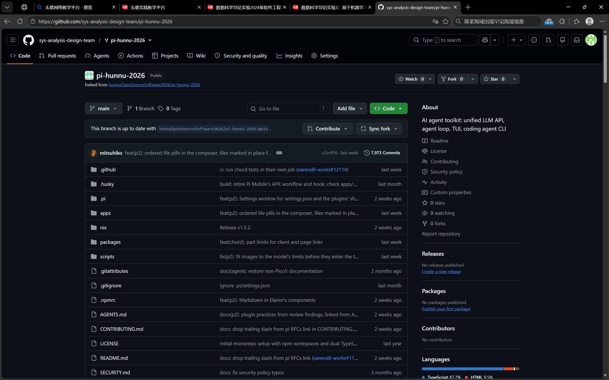
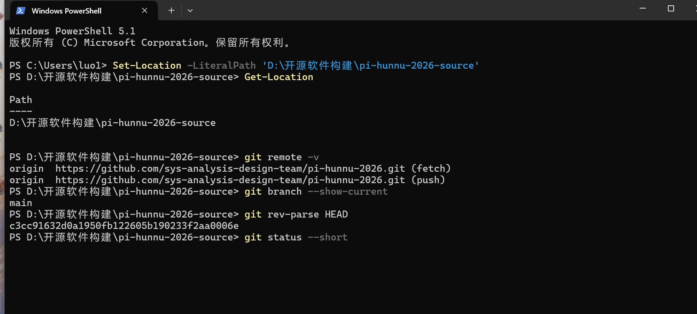
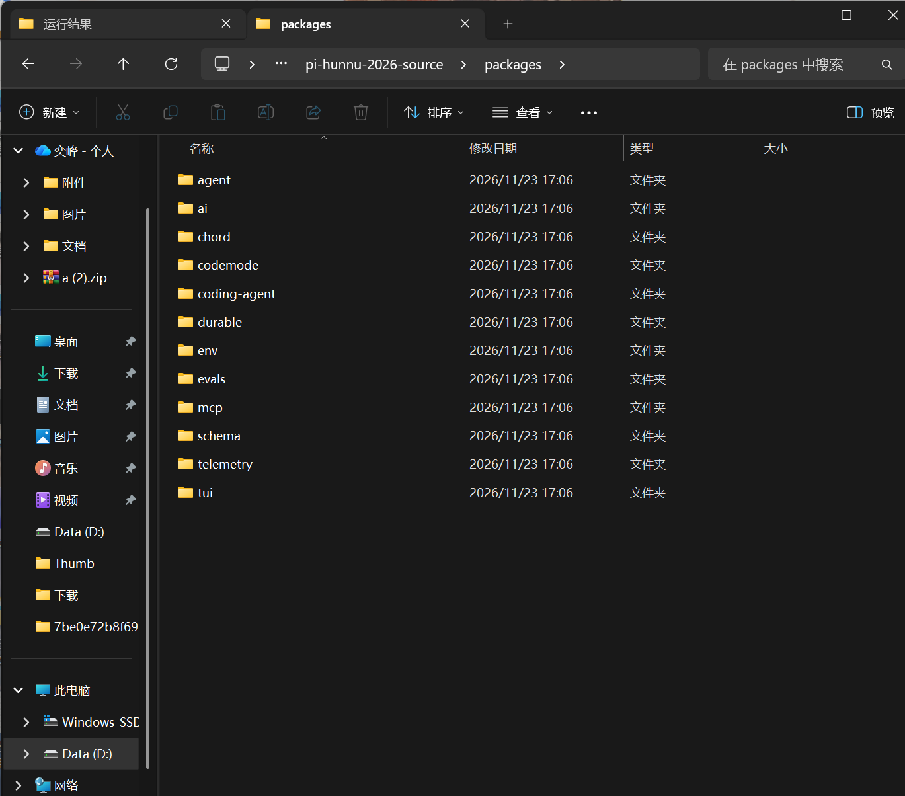
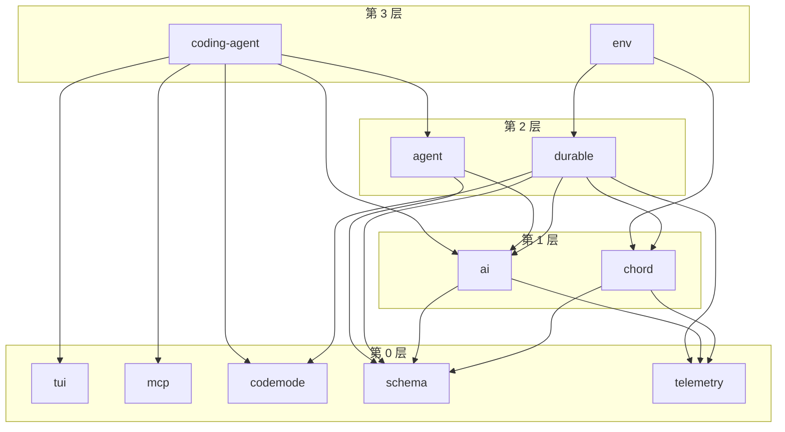

# 实践课 2 · 组织建仓与 Pi Agent 源码分析

姓名：罗奕峰  
本人重点分析的模块：`agent`，重点阅读 `agent-loop.ts` 中的工具调用与参数校验流程。

本报告依据小组组织仓库 `sys-analysis-design-team/pi-hunnu-2026` 的 `main` 分支，分析版本为 `c3cc91632d0a1950fb122605b190233f2aa0006e`。已核对本地源码中的 11 个模块、构建脚本、内部依赖声明，以及重点阅读的工具参数校验流程。

## 一、获取源码

| 项目 | 实际记录 |
| --- | --- |
| 小组 Organization | `sys-analysis-design-team` |
| 小组仓库主页 | https://github.com/sys-analysis-design-team/pi-hunnu-2026 |
| 实际 clone URL | https://github.com/sys-analysis-design-team/pi-hunnu-2026.git |
| 本地目录 | `D:\开源软件构建\pi-hunnu-2026-source` |
| 当前分支 | `main` |
| 完整提交号 | `c3cc91632d0a1950fb122605b190233f2aa0006e` |
| 工作区状态 | `git status --short` 无输出，工作区干净 |

小组仓库主页显示其所属组织为 `sys-analysis-design-team`，fork 来源为 `hunnuOpenSourceSoftware2026/pi-hunnu-2026`。本人的 GitHub 账号 `nexus610` 已具有仓库读取和推送权限。



本次在已有课程工作目录中执行以下命令获取源码。路径含中文，后续编译若出现路径相关问题，再迁移到英文目录并更新记录。

```powershell
git clone --branch main https://github.com/sys-analysis-design-team/pi-hunnu-2026.git pi-hunnu-2026-source
Set-Location pi-hunnu-2026-source
Get-Location
git remote -v
git branch --show-current
git rev-parse HEAD
git status --short
Get-ChildItem -Name
Get-ChildItem packages -Directory -Name
```

本地终端 S1 显示仓库路径、`origin`、`main` 分支和完整提交号。



源码目录截图显示 `packages/` 下的模块。目录还包含 `evals`，根目录通过单独的 `eval` 脚本调用它，因此以下构建顺序和依赖图按 `scripts.build` 涉及的 11 个模块分析。



## 二、构建顺序

[根目录 `package.json`](https://github.com/sys-analysis-design-team/pi-hunnu-2026/blob/c3cc91632d0a1950fb122605b190233f2aa0006e/package.json) 的 `scripts.build` 给出执行顺序。

```text
telemetry → schema → chord → tui → codemode → mcp → ai → durable → env → agent → coding-agent
```

根目录的 `build:offline` 保持这 11 个模块的执行顺序，在 `ai` 处调用 `npm run build:offline`，跳过通常 `build` 开头的模型目录生成步骤，仍校验已有模型数据并编译。依赖图中的箭头从使用方指向被依赖方。

## 三、模块分析

表中的「直接内部依赖」取自各模块 `package.json` 的 `dependencies`，范围为本次的 11 个模块。以下输出根据脚本和配置静态核对。表中的 `tsc` 指 `tsc -p tsconfig.build.json`，产物为模块 `dist/` 下的 JavaScript、类型声明和配置启用的映射文件。

| 模块 | 主要职责 | `build` 行为与产物 | 直接内部依赖 | 依据 |
| --- | --- | --- | --- | --- |
| `telemetry` | 为 Span、指标、上下文传播和遥测记录定义接口，提供类型化的遥测定义和空实现。 | `tsc`，输出 `dist/`，含主入口和指标相关代码。 | 无 | [脚本](https://github.com/sys-analysis-design-team/pi-hunnu-2026/blob/c3cc91632d0a1950fb122605b190233f2aa0006e/packages/telemetry/package.json) · [Span 与指标接口](https://github.com/sys-analysis-design-team/pi-hunnu-2026/blob/c3cc91632d0a1950fb122605b190233f2aa0006e/packages/telemetry/src/index.ts) |
| `schema` | 把 JSON Schema 编译成验证逻辑，支持数据校验和按规则进行类型转换。 | `tsc`，输出 `dist/`，含主入口和格式校验入口。 | 无 | [脚本](https://github.com/sys-analysis-design-team/pi-hunnu-2026/blob/c3cc91632d0a1950fb122605b190233f2aa0006e/packages/schema/package.json) · [验证器](https://github.com/sys-analysis-design-team/pi-hunnu-2026/blob/c3cc91632d0a1950fb122605b190233f2aa0006e/packages/schema/src/validator.ts) |
| `chord` | 提供跨进程应用所需的文档、契约、存储和批量写入等基础能力。 | `tsc`，输出 `dist/`，含公开入口及存储、同步等子入口。 | `schema`、`telemetry` | [脚本](https://github.com/sys-analysis-design-team/pi-hunnu-2026/blob/c3cc91632d0a1950fb122605b190233f2aa0006e/packages/chord/package.json) · [文档与存储入口](https://github.com/sys-analysis-design-team/pi-hunnu-2026/blob/c3cc91632d0a1950fb122605b190233f2aa0006e/packages/chord/src/index.ts) |
| `tui` | 处理终端输入和界面渲染，提供编辑器、列表、Markdown 等组件。 | `tsc`，输出 `dist/`。原生平台组件由单独的 `build:native:*` 脚本构建。 | 无 | [脚本](https://github.com/sys-analysis-design-team/pi-hunnu-2026/blob/c3cc91632d0a1950fb122605b190233f2aa0006e/packages/tui/package.json) · [界面组件入口](https://github.com/sys-analysis-design-team/pi-hunnu-2026/blob/c3cc91632d0a1950fb122605b190233f2aa0006e/packages/tui/src/index.ts) |
| `codemode` | 使用 QuickJS 沙盒执行 JavaScript，向脚本提供宿主注入的工具和相应类型声明。 | `tsc`，输出 `dist/`，含宿主入口、工具声明入口和 worker 入口。 | 无 | [脚本](https://github.com/sys-analysis-design-team/pi-hunnu-2026/blob/c3cc91632d0a1950fb122605b190233f2aa0006e/packages/codemode/package.json) · [沙盒与工具声明入口](https://github.com/sys-analysis-design-team/pi-hunnu-2026/blob/c3cc91632d0a1950fb122605b190233f2aa0006e/packages/codemode/src/index.ts) |
| `mcp` | 实现 MCP 客户端，处理请求、传输、认证接口和工具输入 Schema 的规范化。 | `tsc`，输出 `dist/`，含客户端和 OAuth 子入口。 | 无 | [脚本](https://github.com/sys-analysis-design-team/pi-hunnu-2026/blob/c3cc91632d0a1950fb122605b190233f2aa0006e/packages/mcp/package.json) · [客户端与传输入口](https://github.com/sys-analysis-design-team/pi-hunnu-2026/blob/c3cc91632d0a1950fb122605b190233f2aa0006e/packages/mcp/src/index.ts) |
| `ai` | 统一模型提供商接口、模型目录、流式事件与工具参数校验。 | 先由 `catalog/generate.ts --strict` 更新模型目录（含 `src/models.generated.ts`），再进入 `build:offline` 校验模型数据、执行 `tsc`，并将提供商数据复制到 `dist/providers/data/`。 | `schema`、`telemetry` | [脚本](https://github.com/sys-analysis-design-team/pi-hunnu-2026/blob/c3cc91632d0a1950fb122605b190233f2aa0006e/packages/ai/package.json) · [目录生成器](https://github.com/sys-analysis-design-team/pi-hunnu-2026/blob/c3cc91632d0a1950fb122605b190233f2aa0006e/packages/ai/catalog/generate.ts) · [工具参数校验](https://github.com/sys-analysis-design-team/pi-hunnu-2026/blob/c3cc91632d0a1950fb122605b190233f2aa0006e/packages/ai/src/utils/validation.ts) |
| `durable` | 用文档和存储组织持久化会话及任务，提供会话创建、任务图、工具注册和存储接口。 | `tsc`，输出 `dist/`，含会话、执行环境与存储相关子入口。 | `chord`、`ai`、`codemode`、`schema`、`telemetry` | [脚本](https://github.com/sys-analysis-design-team/pi-hunnu-2026/blob/c3cc91632d0a1950fb122605b190233f2aa0006e/packages/durable/package.json) · [会话、任务与存储入口](https://github.com/sys-analysis-design-team/pi-hunnu-2026/blob/c3cc91632d0a1950fb122605b190233f2aa0006e/packages/durable/src/index.ts) |
| `env` | 提供运行环境客户端，封装本地目录读取、远程进程、终端和文件监视等操作。 | `tsc`，输出 TypeScript 客户端的 `dist/`。Rust 守护进程有单独的 `build:daemon`。 | `chord`、`durable` | [脚本](https://github.com/sys-analysis-design-team/pi-hunnu-2026/blob/c3cc91632d0a1950fb122605b190233f2aa0006e/packages/env/package.json) · [运行环境入口](https://github.com/sys-analysis-design-team/pi-hunnu-2026/blob/c3cc91632d0a1950fb122605b190233f2aa0006e/packages/env/src/index.ts) |
| `agent` | 管理 Agent 状态并运行交互循环，把模型流式输出、工具调用和事件组织成一轮或多轮执行。处理工具调用时，它先整理参数，再调用 `ai` 提供的 `validateToolArguments` 进行校验。如果配置了 `beforeToolCall`，它会把校验后的参数传给该回调。 | 执行 `tsc -p tsconfig.build.json`，将 `src/` 下的 TypeScript 源码编译成 JavaScript，并把 JavaScript 和类型声明输出到 `dist/`。 | `ai`、`schema` | [脚本](https://github.com/sys-analysis-design-team/pi-hunnu-2026/blob/c3cc91632d0a1950fb122605b190233f2aa0006e/packages/agent/package.json) · [构建配置](https://github.com/sys-analysis-design-team/pi-hunnu-2026/blob/c3cc91632d0a1950fb122605b190233f2aa0006e/packages/agent/tsconfig.build.json) · [交互循环](https://github.com/sys-analysis-design-team/pi-hunnu-2026/blob/c3cc91632d0a1950fb122605b190233f2aa0006e/packages/agent/src/agent-loop.ts) |
| `coding-agent` | 将通用 Agent 封装成 Pi 命令行应用，负责会话、配置、交互界面、扩展和内置开发工具。 | 先执行 `build:unbundled`，编译到 `dist/`、设置入口可执行属性并复制主题、图片和 HTML 导出资源。再通过 esbuild 生成 `dist/bundle/` 下的 CLI、RPC 入口与所需分包。 | `agent`、`ai`、`codemode`、`mcp`、`tui` | [脚本](https://github.com/sys-analysis-design-team/pi-hunnu-2026/blob/c3cc91632d0a1950fb122605b190233f2aa0006e/packages/coding-agent/package.json) · [会话代码](https://github.com/sys-analysis-design-team/pi-hunnu-2026/blob/c3cc91632d0a1950fb122605b190233f2aa0006e/packages/coding-agent/src/core/agent-session.ts) · [打包脚本](https://github.com/sys-analysis-design-team/pi-hunnu-2026/blob/c3cc91632d0a1950fb122605b190233f2aa0006e/scripts/build-coding-agent-bundle.mjs) |

## 四、模块层级与依赖图

箭头从使用方指向它在 `dependencies` 中声明的直接内部依赖。层级按依赖深度划分。没有图内依赖的包在第 0 层，每个其他包的层数是其直接依赖的最高层数加一。例如，`env` 依赖第 2 层的 `durable`，因此位于第 3 层。

图中的 `agent → schema` 对应 `agent` 的 `dependencies` 中声明的 `@earendil-works/pi-schema`。第三问追踪的 `agent → ai → schema` 则经过两条边，展示工具参数校验如何在三个模块之间传递。[`agent` 的依赖声明](https://github.com/sys-analysis-design-team/pi-hunnu-2026/blob/c3cc91632d0a1950fb122605b190233f2aa0006e/packages/agent/package.json) · [`ai` 的依赖声明](https://github.com/sys-analysis-design-team/pi-hunnu-2026/blob/c3cc91632d0a1950fb122605b190233f2aa0006e/packages/ai/package.json)

[Mermaid 图源](依赖图.mmd)



## 五、问题回答

### 1. 根目录和子模块各自怎样执行 `npm run build`？

根目录的 npm 从根 `package.json` 读取 `scripts.build`。各模块的构建次序由脚本中的 `cd` 和 `npm run build` 显式指定。每次切换到一个模块目录，就调用该目录的 `npm run build`。串接命令的 `&&` 要求上一步成功，某一步失败时后续模块就不会继续执行。

进入子模块后，npm 读取该模块的 `package.json`。11 个模块最终都调用 TypeScript 的 `tsc -p tsconfig.build.json`，各自的构建配置都继承根目录的 `tsconfig.base.json`，并把编译产物写到模块自己的 `dist/`。例如，`agent` 还通过 `paths` 把部分 `ai` 导入映射到 `ai` 已生成的类型声明。`ai` 的脚本包含模型数据生成、校验和复制步骤，`coding-agent` 的脚本会复制界面资源并打包应用入口。[公共 TypeScript 配置](https://github.com/sys-analysis-design-team/pi-hunnu-2026/blob/c3cc91632d0a1950fb122605b190233f2aa0006e/tsconfig.base.json) · [`agent` 构建配置](https://github.com/sys-analysis-design-team/pi-hunnu-2026/blob/c3cc91632d0a1950fb122605b190233f2aa0006e/packages/agent/tsconfig.build.json)

### 2. 构建顺序与依赖的关系是什么？

构建时，有依赖的包需要在使用方之前准备好。例如，`agent` 的构建需要 `ai` 输出的声明文件，因此根脚本先构建 `ai`，再构建 `agent`。根脚本将这些先后约束排成单条顺序。顺序相邻只表示脚本接着执行，例如 `telemetry` 和 `schema` 在构建中相邻，但两者的包配置里都没有声明对方为依赖。

### 3. 一条依赖路径中的模块如何分工？

以 `agent → ai → schema` 为例，模型发起工具调用时，三个模块按下面的方式分工。

1. `agent` 负责组织调用流程。它先用 `prepareToolCallArguments` 整理参数，再把工具定义和整理后的调用交给 `ai` 的 `validateToolArguments`。如果配置了 `beforeToolCall`，就将校验后的参数传给该回调。[Agent 循环](https://github.com/sys-analysis-design-team/pi-hunnu-2026/blob/c3cc91632d0a1950fb122605b190233f2aa0006e/packages/agent/src/agent-loop.ts)
2. `ai` 负责把工具声明接入参数校验。`getValidator` 接收工具的参数 Schema，先检查缓存。没有可复用的验证器时，它调用 `schema` 的 `compile`，启用 `coerce: true`，并缓存得到的验证器。[工具参数校验](https://github.com/sys-analysis-design-team/pi-hunnu-2026/blob/c3cc91632d0a1950fb122605b190233f2aa0006e/packages/ai/src/utils/validation.ts)
3. `schema` 提供通用验证器，把 JSON Schema 规则编译成可执行的校验逻辑。在这个调用中，`coerce: true` 允许验证器按规则尝试转换输入类型。[验证器实现](https://github.com/sys-analysis-design-team/pi-hunnu-2026/blob/c3cc91632d0a1950fb122605b190233f2aa0006e/packages/schema/src/validator.ts)
