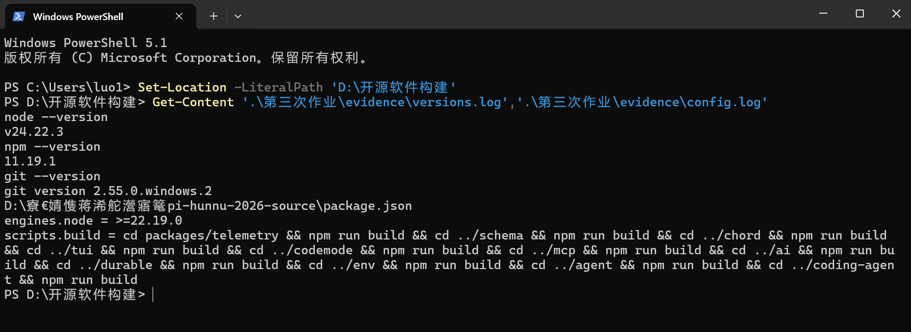
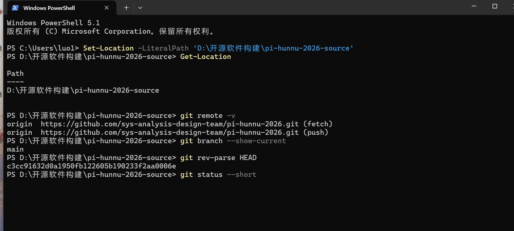
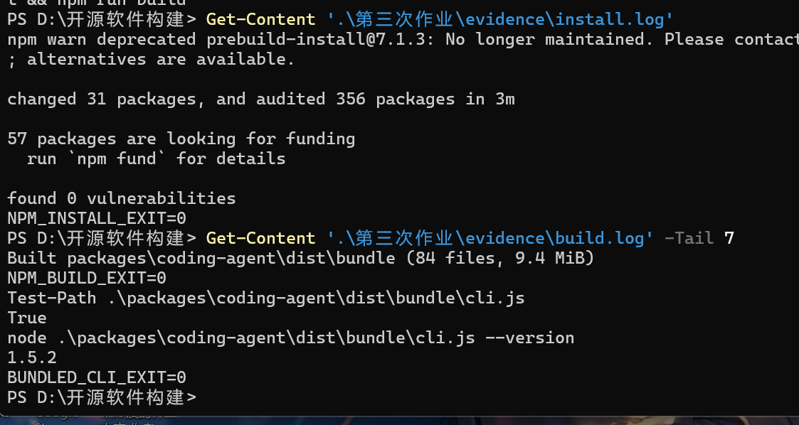
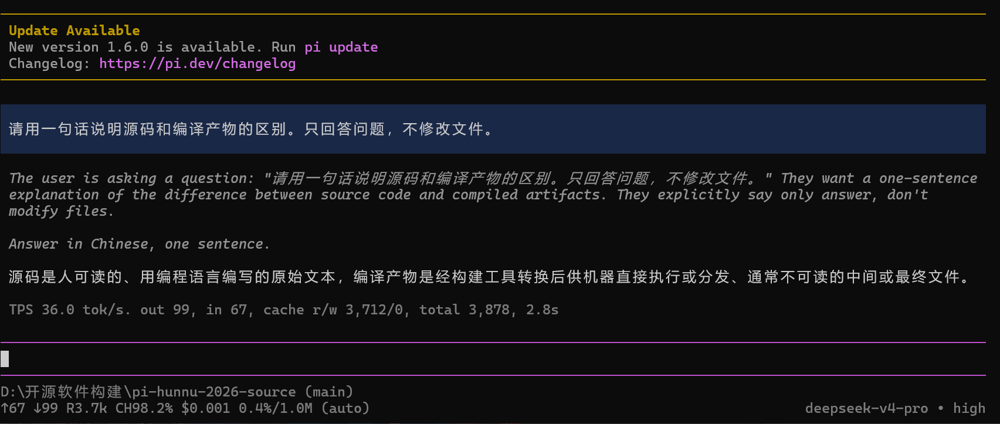

# 实践课 3 · Pi Agent 源码安装与编译

姓名：罗奕峰

GitHub：`nexus610`

## 一、实验环境

| 工具 | 实验版本 |
| --- | --- |
| Node.js | `v24.22.3` |
| npm | `11.19.1` |
| Git for Windows | `2.55.0.windows.2` |

本机默认的 Node.js 是 `v22.23.4`。根项目的 `engines.node` 要求 `>=22.19.0`，本次源码中的 `apps/p3` 工作区要求 `>=24.4.0`。由于从仓库根目录安装会处理工作区依赖，本次使用校验过 SHA-256 的 Node.js 24 官方便携版，仅在实验终端中将它放到 `PATH` 前面。[根配置](https://github.com/sys-analysis-design-team/pi-hunnu-2026/blob/c3cc91632d0a1950fb122605b190233f2aa0006e/package.json#L69) · [p3 工作区配置](https://github.com/sys-analysis-design-team/pi-hunnu-2026/blob/c3cc91632d0a1950fb122605b190233f2aa0006e/apps/p3/package.json#L17)

## 二、源码来源与版本

复用实践课 2 已克隆的本地仓库，`origin` 为 `https://github.com/sys-analysis-design-team/pi-hunnu-2026.git`。本地目录是 `D:\开源软件构建\pi-hunnu-2026-source`，分支为 `main`，完整提交号为 `c3cc91632d0a1950fb122605b190233f2aa0006e`。

## 三、安装与构建配置

仓库根目录的 `package.json` 用 `workspaces` 声明同仓库的多个包，用 `engines.node` 声明 Node.js 版本要求。根目录的 `package-lock.json` 记录依赖解析结果，`packages/` 保存子包源码。

在根目录执行 `npm run build` 时，npm 读取根 `package.json` 的 `scripts.build`。根脚本按固定顺序切换到 11 个子包，每次再读取该子包的 `scripts.build`。命令以 `&&` 串接，前一步成功才会进入下一步。最后构建的 `coding-agent` 在 `bin.pi` 中声明了命令行入口 `dist/bundle/cli.js`。[开发说明](https://github.com/sys-analysis-design-team/pi-hunnu-2026/blob/c3cc91632d0a1950fb122605b190233f2aa0006e/README.md#L102) · [根构建脚本](https://github.com/sys-analysis-design-team/pi-hunnu-2026/blob/c3cc91632d0a1950fb122605b190233f2aa0006e/package.json#L15) · [CLI 配置](https://github.com/sys-analysis-design-team/pi-hunnu-2026/blob/c3cc91632d0a1950fb122605b190233f2aa0006e/packages/coding-agent/package.json#L9)

S3 与 S1 共用上方截图，其中记录了 `engines.node` 和 `scripts.build`。截图中配置文件路径的中文部分因 Windows PowerShell 5.1 读取 UTF-8 日志时的编码差异显示为乱码。实际配置文件是本地源码根目录的 `package.json`。

## 四、安装项目依赖

在仓库根目录执行 `npm install --ignore-scripts`。npm 根据根配置和锁文件安装项目依赖到本地 `node_modules`，并链接工作区包。`--ignore-scripts` 跳过安装时自动触发的生命周期脚本，后续仍可显式运行 `npm run build`。

恢复实践时，在同一仓库根目录重新执行安装。此次安装耗时约 3 分钟，npm 报告变更 31 个包、审计 356 个包，退出码为 `0`。日志中出现了 `prebuild-install@7.1.3` 的弃用警告，安装最终成功。本次依赖审计报告 `found 0 vulnerabilities`。

## 五、本地编译与产物验证

首次构建使用 `npm run build`，其中 `ai` 会获取并生成模型目录配置。构建结束后检查退出码，再用 `Test-Path .\packages\coding-agent\dist\bundle\cli.js` 和 `node .\packages\coding-agent\dist\bundle\cli.js --version` 分别验证产物存在和产物可运行。

模型目录生成后通过了 `check:model-data`，根构建完成并返回退出码 `0`。`coding-agent` 打包日志显示输出目录中生成了 84 个文件，约 9.4 MiB。检查 `dist/bundle/cli.js` 得到 `True`，再用 Node.js 运行该文件的 `--version`，得到版本 `1.5.2` 和退出码 `0`。

S5 与 S4 共用上方截图，下半部分显示构建结束、产物存在和 CLI 版本验证。

## 六、运行源码版并完成一次会话

从仓库根目录运行 `.\pi-test.bat --version` 检查版本，再通过 `.\pi-test.bat` 启动交互模式。批处理文件调用 `pi-test.ps1`，后者通过 Node.js 加载源码解析器，入口为 `packages/coding-agent/src/cli.ts`。源码入口适合在修改 TypeScript 后快速验证行为。编译后的 `dist/bundle/cli.js` 适合验证构建出的 CLI。[批处理入口](https://github.com/sys-analysis-design-team/pi-hunnu-2026/blob/c3cc91632d0a1950fb122605b190233f2aa0006e/pi-test.bat) · [PowerShell 启动脚本](https://github.com/sys-analysis-design-team/pi-hunnu-2026/blob/c3cc91632d0a1950fb122605b190233f2aa0006e/pi-test.ps1)

本地源码入口的 `--version` 返回 `1.5.2`，退出码为 `0`。随后从源码目录运行 `.\pi-test.bat --no-tools --no-session`，在交互界面中使用 `deepseek-v4-pro` 完成一次问答。

- 提示词：请用一句话说明源码和编译产物的区别。只回答问题，不修改文件。
- 实际回复：源码是人可读的、用编程语言编写的原始文本，编译产物是经构建工具转换后供机器直接执行或分发、通常不可读的中间或最终文件。

## 七、遇到的困难及解决过程

### 工作区和根目录的 Node.js 要求不同

检查锁文件时发现 `apps/p3` 的版本要求高于根项目。本机原有 Node.js 22 满足根要求，但低于该工作区要求。为使根目录安装同时满足两者，我使用 Node.js 24 官方便携版，并重新核对 Node.js、npm 和 Git 的实际版本。

### 安装中断与恢复

首次安装因暂停实验而中止。恢复后在原仓库目录使用同一套 Node.js 24 和 npm 缓存重新安装，并以最终退出码 `0` 确认安装已完成。
