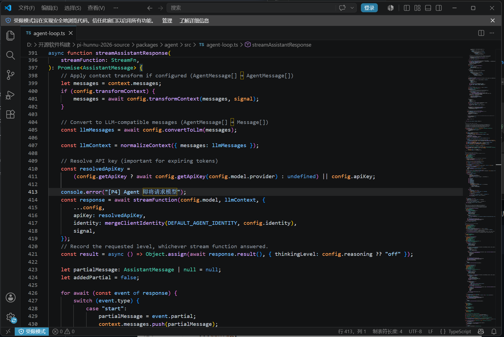
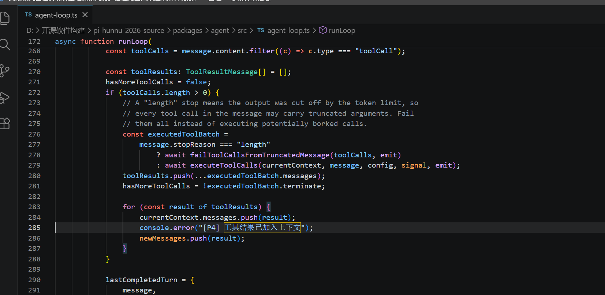
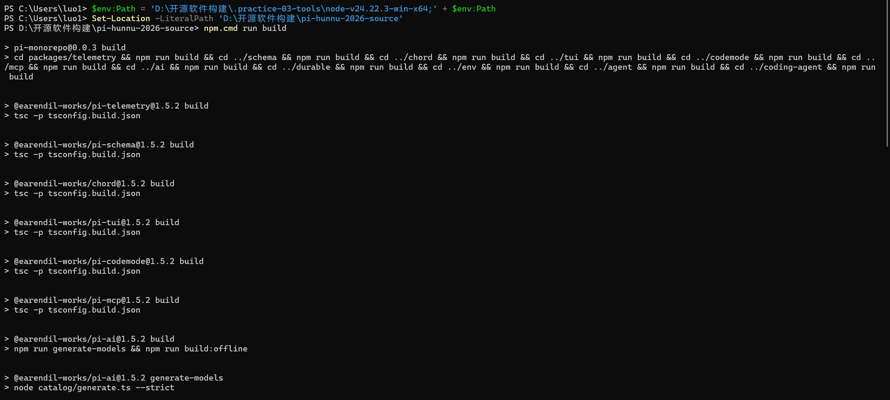
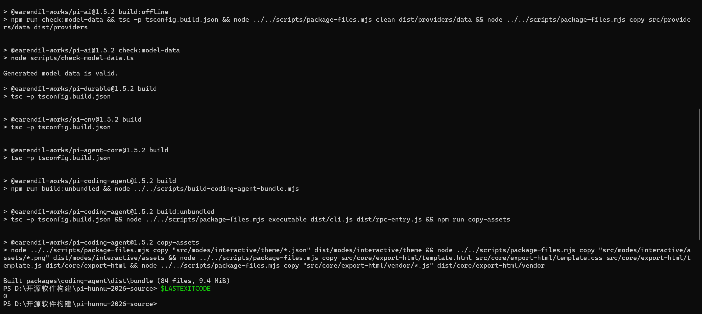
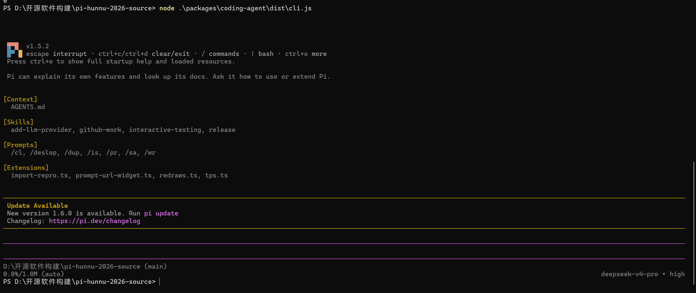
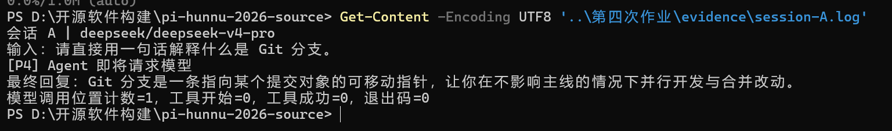
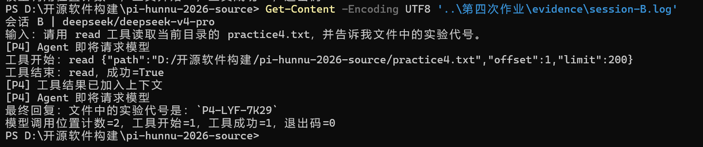
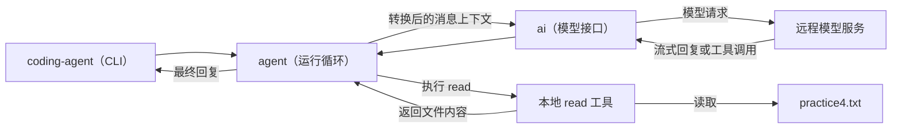

# 实践课 4 · Pi Agent 模型调用与运行流程

姓名：罗奕峰

GitHub：`nexus610`

实验使用实践课 3 的本地小组仓库 `D:\开源软件构建\pi-hunnu-2026-source`，基础提交为 `c3cc91632d0a1950fb122605b190233f2aa0006e`。本次使用 Node.js `v24.22.3` 和 npm `11.19.1`。[小组源码仓库](https://github.com/sys-analysis-design-team/pi-hunnu-2026) · [实践课 3 报告](https://github.com/nexus610/pi-agent-practice-01/blob/main/practice-03/README.md)

## 一、源码修改

两处修改都在 `packages/agent/src/agent-loop.ts`，使用 `console.error` 将标记写到标准错误。

- 修改后的第 413 行，在 `await streamFunction(...)` 之前记录 Agent 到达模型调用的位置。
- 修改后的第 285 行，在工具结果写入 `currentContext.messages` 后记录一次。日志放在 `for` 循环内，每写入一条结果就打印一次。

```diff
 for (const result of toolResults) {
     currentContext.messages.push(result);
+    console.error("[P4] 工具结果已加入上下文");
     newMessages.push(result);
 }

+console.error("[P4] Agent 即将请求模型");
 const response = await streamFunction(config.model, llmContext, {
```





## 二、重新编译与启动

在源码根目录执行 `npm run build`。构建完成后捕获的退出码是 `0`。随后对本次编译出的入口运行 `node .\packages\coding-agent\dist\cli.js --version`，实际返回 `1.5.2`。下面的两次实验也从这个入口启动。仓库的 `npm run check` 同样返回 `0`。







## 三、运行记录

实验文件 `practice4.txt` 位于源码仓库根目录，只包含一行实验代号 `P4-LYF-7K29`。A、B 都使用 `deepseek/deepseek-v4-pro`，用 `--no-session` 启动两个独立进程，并用 `--tools read` 将可用工具限定为 `read`。`--mode json` 输出会话事件，方便核对实际工具调用和两类日志的顺序。会话 B 的输入只提供文件名。

| 观察项 | A · 直接问答 | B · 读取文件 |
| --- | --- | --- |
| 输入指令 | 请直接用一句话解释什么是 Git 分支。 | 请用 read 工具读取当前目录的 practice4.txt，并告诉我文件中的实验代号。 |
| 工具调用 | 0 次 | `read` 读取 `practice4.txt`，成功 1 次 |
| 到达模型调用位置 | 1 次 | 2 次 |
| 最终回复 | Git 分支是一条指向某个提交对象的可移动指针，让你在不影响主线的情况下并行开发与合并改动。 | 文件中的实验代号是：`P4-LYF-7K29` |
| 退出码 | `0` | `0` |

会话 A 的实际日志只有一条。

```text
[P4] Agent 即将请求模型
```

会话 B 的实际日志顺序如下。工具事件显示，第一次模型请求与工具结果入上下文之间，`read` 开始并成功完成了本地读取。

```text
[P4] Agent 即将请求模型
[P4] 工具结果已加入上下文
[P4] Agent 即将请求模型
```





## 四、运行流程



远程模型可以发出读取文件的工具调用请求。本地进程中的 `read` 工具实际读取文件，Agent 把返回内容作为工具结果写入消息上下文。下一轮请求带上这条工具结果和对应的工具调用，模型便能根据文件内容回答。
