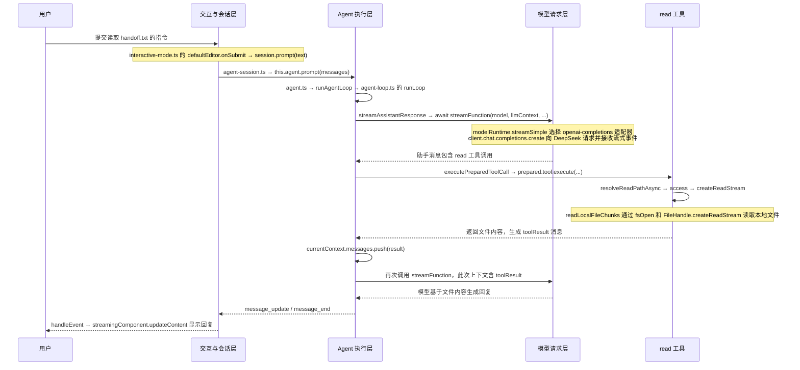
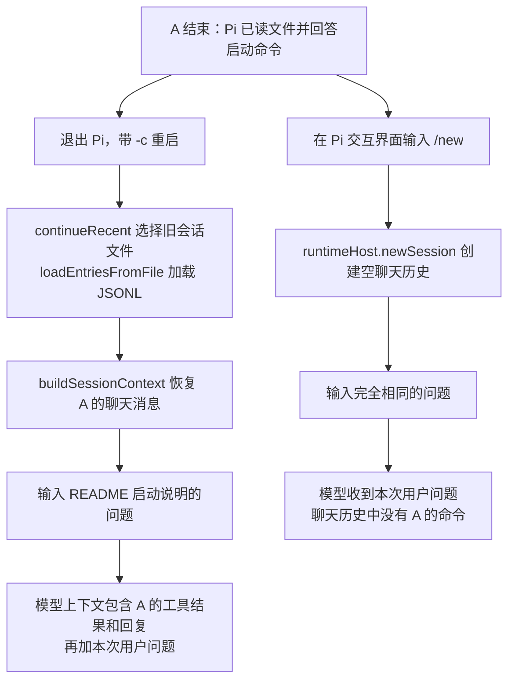

# 实践 05 · Pi Agent 源码泛读与功能定位

- 姓名：罗奕峰
- GitHub：`nexus610`
- 实验环境：Windows，Node.js 24.22.3，Pi 1.5.2，`deepseek/deepseek-v4-pro`
- 小组源码基础提交：`c3cc91632d0a1950fb122605b190233f2aa0006e`，本地编译产物保留实践 04 的两处 `[P4]` 日志。[小组源码仓库](https://github.com/sys-analysis-design-team/pi-hunnu-2026)

## A. 单轮交互与工具调用

在独立的实验目录创建 `handoff.txt`，写入待办「补充 README 的启动说明」和启动命令 `npm run demo -- --profile lyf-43809`。从实验目录用 Node.js 启动本地编译的 `packages/coding-agent/dist/cli.js`，使用独立的 `--session-dir` 保存对话。这一轮通过 Pi 的交互界面提交问题，随后用终端输出和会话文件核对日志及工具结果。

实际输入为「请用 read 工具读取当前目录的 handoff.txt，原样告诉我待办和启动命令。」输入只给了文件名。Pi 成功调用了一次 `read`，回答中包含待办和完整的启动命令。一次用户输入触发了两轮模型请求。

```text
[P4] Agent 即将请求模型
[P4] 工具结果已加入上下文
[P4] Agent 即将请求模型
```

### 图 1 · 读取交接文件的代码级时序



原始工具调用的 `offset` 和 `limit` 都是 `null`。用同一构建中的 `validateToolArguments` 和 `read` 的真实参数定义做本地验证后，传给工具的参数只剩文件路径。因此 `isStreamableRange(undefined, undefined)` 成立，文本读取走 `selectLinesFromStream` 和 `ops.createReadStream`。实际读取发生在本地，模型从第二轮上下文中的工具结果获得文件内容。[参数校验](https://github.com/sys-analysis-design-team/pi-hunnu-2026/blob/c3cc91632d0a1950fb122605b190233f2aa0006e/packages/ai/src/utils/validation.ts#L46) · [read 的分支](https://github.com/sys-analysis-design-team/pi-hunnu-2026/blob/c3cc91632d0a1950fb122605b190233f2aa0006e/packages/coding-agent/src/core/tools/read.ts#L296)

| 定位点 | 对应源码 |
| --- | --- |
| 输入与输出 | [`interactive-mode.ts` 的 `onSubmit`](https://github.com/sys-analysis-design-team/pi-hunnu-2026/blob/c3cc91632d0a1950fb122605b190233f2aa0006e/packages/coding-agent/src/modes/interactive/interactive-mode.ts#L3325) · [`subscribeToAgent`](https://github.com/sys-analysis-design-team/pi-hunnu-2026/blob/c3cc91632d0a1950fb122605b190233f2aa0006e/packages/coding-agent/src/modes/interactive/interactive-mode.ts#L3525) · [`message_update`](https://github.com/sys-analysis-design-team/pi-hunnu-2026/blob/c3cc91632d0a1950fb122605b190233f2aa0006e/packages/coding-agent/src/modes/interactive/interactive-mode.ts#L3649) |
| 执行循环 | [`Agent.prompt`](https://github.com/sys-analysis-design-team/pi-hunnu-2026/blob/c3cc91632d0a1950fb122605b190233f2aa0006e/packages/agent/src/agent.ts#L380) · [工具结果写入上下文](https://github.com/sys-analysis-design-team/pi-hunnu-2026/blob/c3cc91632d0a1950fb122605b190233f2aa0006e/packages/agent/src/agent-loop.ts#L283) |
| 模型与文件边界 | [`sdk.ts` 的模型运行时](https://github.com/sys-analysis-design-team/pi-hunnu-2026/blob/c3cc91632d0a1950fb122605b190233f2aa0006e/packages/coding-agent/src/core/sdk.ts#L422) · [模型请求适配器](https://github.com/sys-analysis-design-team/pi-hunnu-2026/blob/c3cc91632d0a1950fb122605b190233f2aa0006e/packages/ai/src/api/openai-completions.ts#L385) · [本地文件流](https://github.com/sys-analysis-design-team/pi-hunnu-2026/blob/c3cc91632d0a1950fb122605b190233f2aa0006e/packages/coding-agent/src/core/tools/read.ts#L76) |

## B. 恢复会话与新建会话

A 完成后，按 `Ctrl+D` 退出 Pi。保持同一实验目录、模型和会话目录，给原启动命令加上 `-c` 重新运行。Pi 的交互界面重新显示了 A 的提问、`read` 记录和包含完整命令的答复。完成续问后，在同一界面输入 `/new`，看到 `New session started`。两份 JSONL 会话文件也分别确认了旧会话包含 A 的工具结果，新会话的第一条用户消息就是本次追问。

两次提交了完全相同的问题：

> 接着上次的待办，给 README 起草一条启动说明，写出交接单里的完整启动命令。只用这次会话已有的信息。不要调用工具。如果缺少命令，请直接说明。

| 观察项 | 加 `-c` 恢复旧会话 | 输入 `/new` 新会话 |
| --- | --- | --- |
| 提问前聊天历史 | 保留 A 的问题、工具调用、工具结果和回答 | 0 条聊天消息 |
| 工具调用 | 0 次 | 0 次 |
| 模型请求 | 1 次 | 1 次 |
| 实际回答节选 | 「在项目根目录执行以下命令即可启动演示程序」并给出 `npm run demo -- --profile lyf-43809` | 「抱歉，我在本次会话中还没有看到任何关于该项目的启动命令或交接单内容，因此无法起草 README 的启动说明。」 |

### 图 2 · 恢复和新建会话时发给模型的聊天消息



两条路径都有正常的系统提示。差别在于是否把 A 的历史消息加回模型上下文。恢复路径从 CLI 的 `createSessionManager` 进入 `SessionManager.continueRecent`，再由 SDK 将 `existingSession.messages` 初始化到 Agent。新建路径创建新的 `SessionManager` 并替换当前会话运行时。[CLI 的恢复入口](https://github.com/sys-analysis-design-team/pi-hunnu-2026/blob/c3cc91632d0a1950fb122605b190233f2aa0006e/packages/coding-agent/src/main.ts#L480) · [历史恢复](https://github.com/sys-analysis-design-team/pi-hunnu-2026/blob/c3cc91632d0a1950fb122605b190233f2aa0006e/packages/coding-agent/src/core/sdk.ts#L409) · [交互 `/new`](https://github.com/sys-analysis-design-team/pi-hunnu-2026/blob/c3cc91632d0a1950fb122605b190233f2aa0006e/packages/coding-agent/src/modes/interactive/interactive-mode.ts#L3429) · [RPC 新建会话](https://github.com/sys-analysis-design-team/pi-hunnu-2026/blob/c3cc91632d0a1950fb122605b190233f2aa0006e/packages/coding-agent/src/modes/rpc/rpc-mode.ts#L456)

要改输入处理或回复样式，可以从交互层入手。要改 `read` 的读取规则，可以查看 `core/tools/read.ts`。要改恢复策略，应在会话管理层检查文件选择和历史重建，再验证 `-c` 与新会话两条路径。
